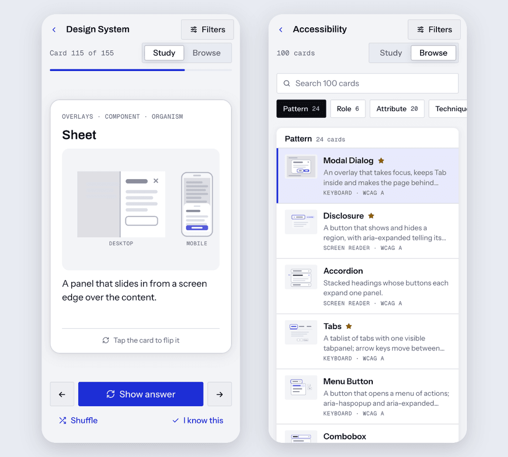

# Flashcards

[](https://flashcards.pearpages.com)
[](https://github.com/pearpages/flashcards/actions/workflows/ci.yml)
[](https://github.com/pearpages/flashcards/actions/workflows/deploy.yml)
[](https://github.com/pearpages/flashcards/releases)
[](LICENSE)

A mobile-first flashcard app with ten decks: design systems, CSS, accessibility, web performance, web security, system design, testing, Next.js, LLM engineering and LLM internals. Every card has a wireframe drawing, and each deck brings its own filters and facets. About a fifth of every deck is starred ★ as the essentials you must know, and you can hide the cards you already know.

The first deck, **Design System**, has 155 components, each tagged three ways: its purpose (forms, navigation, overlays…), its layer (primitive, component, pattern) and its atomic design level (atom, molecule, organism, template). Each card has wireframe drawings and, for most, the iOS and Android equivalents.

A second deck, **Accessibility**, covers 100 ARIA patterns, roles and attributes, techniques and WCAG 2.2 criteria, filtered by kind and by who they help most (screen reader, keyboard, low vision, motor, cognitive, hearing, vestibular, photosensitive), with the WCAG level on each card and the SwiftUI and Compose equivalents.

A third deck, **System Design**, has 104 building blocks, patterns and principles of backend systems (caching, messaging, consistency, reliability…), each with the AWS, Google Cloud and Azure service where one exists.

A fourth deck, **Web Security**, has 100 attacks, defences and mechanisms (injection, browser, auth, sessions, transport, data, supply chain, infrastructure), each tagged with its OWASP Top 10 (2025) category.

A fifth deck, **Web Performance**, has 100 metrics, mechanisms, techniques and anti-patterns (measurement, network, server, caching, loading, assets, JavaScript, rendering), each tagged with the Core Web Vital or other metric it mainly improves.

A sixth deck, **CSS**, has 100 cards from the cascade and selectors through flexbox, grid, positioning, responsive design, typography, colour and motion to architecture, each with its Baseline status and, for layout, the SwiftUI and Compose equivalent.

A seventh deck, **Testing**, has 100 cards on strategy, test doubles, unit to end-to-end, APIs, non-functional checks, CI and suite maintenance, each with its test level and, where an API maps exactly, the JavaScript (Vitest, Testing Library, Playwright) and Python (pytest) way to do it.

An eighth deck, **Next.js**, has 104 interview-style questions on the App Router: routing, Server and Client Components, data fetching, caching, Server Actions, proxy, images and fonts, metadata, config and deploys, each tagged with where its code runs (server, client, edge, build).

A ninth deck, **LLM Engineering**, has 107 cards on building with LLMs: models, prompting, context, tools, retrieval, agents, evals, safety, cost and deploys, each tagged with the stage where it starts to matter (prototype, production, scale) and, where one exists, the Anthropic, OpenAI and Google feature for it.

A tenth deck, **LLM Internals**, has 100 cards on how the models work inside: tokens, transformer architecture, attention, training, alignment, inference, efficiency, scaling and interpretability, each tagged with when it happens (pretraining, post-training, inference).

**Try it: [flashcards.pearpages.com](https://flashcards.pearpages.com)** — works on phones and desktop, no sign-up.



## Tech Stack

- **Vite** + **React** + **TypeScript**
- **Framer Motion** — card stack animations, swipe gestures, spring physics
- **pulp** — the design system: tokens, CSS and React components (`@pearpages/pulp-*`), [ADR-0019](docs/adr/0019-pulp-design-system.md)
- **Plain CSS** on pulp tokens — one stylesheet per component, no utility frameworks
- **pnpm** — package manager
- **Vitest** — unit tests
- **@pearpages/credit** — the shared "Made by pearpages" footer

## Requirements

- Node.js >= 22
- pnpm

## Features

- **Browse by purpose** — every component listed in sections by purpose, with search (names, other names, summaries) and a jump bar; tap one to study it. A sidebar next to the cards on desktop, a Study/Browse switch on mobile
- **Deck picker** — the home screen lists every deck with a drawing and its card and essential counts; a back arrow returns to it, and entering a deck starts fresh
- **Shareable links** — the URL follows the deck and card you're on (`#/design-system/card/sheet`) or the list (`#/design-system/browse`), and the Back button works
- **Component deck** — name, purpose, layer, atomic level, wireframe illustration and one-line purpose on the front
- **Tap to flip** — tap/click (or arrow up/down) to show when to use it, nearest alternatives, accessibility notes and native equivalents; tap again to go back to the front
- **Essentials ★** — the must-know fifth of every deck is painted gold and starred in the list; "Essential cards only" in Filters studies only those
- **I know this** — the button under the card (or `H`) takes it out of study, with Undo in a toast; known cards are remembered per deck in this browser only, stay in the list faded with a Put back button, and "Show cards I know" in Filters brings them back into study
- **Filters** — a sheet (bottom on phones, side panel on desktop) with one chip group per filter the deck declares, each with its card count; the other facets show as a line on the card
- **Desktop + mobile** — components that change shape on small screens show both versions side by side, or desktop · iOS · Android when the platforms differ
- **Platform equivalents** — revealing a card shows its counterparts on the platforms its deck declares: iOS (SwiftUI/UIKit) and Android (Compose Material 3) for the UI decks, AWS, GCP and Azure for system design, Anthropic, OpenAI and Google for LLM engineering; search finds them too
- **Multiple decks** — add a folder under `src/decks/` and it shows up on the deck picker
- **Swipe navigation** — swipe left/right to navigate between cards
- **Keyboard navigation** — left/right arrow keys
- **Shuffle** — randomise the current deck, with Undo
- **Progress** — "Card 3 of 100" and a progress bar above the card
- **Mobile-first design** — full-width on mobile, centered and constrained on desktop
- **Spring animations** — natural card movement with Framer Motion spring physics

## Decks

Each deck is a folder in `src/decks/` and owns all of its data. The app discovers decks automatically and lists them on the home screen.

```
src/decks/
  accessibility/       # same layout as design-system
  design-system/
    deck.json          # title, description, the filters (facets) and the platform columns
  system-design/       # same layout, with AWS / GCP / Azure as its platforms
  web-security/        # same layout, no platform columns
  web-performance/     # same layout, no platform columns
  css/                 # same layout, with SwiftUI / Compose as its platforms
  testing/             # same layout, with JavaScript / Python as its platforms
  nextjs/              # same layout, no platform columns
  llm-engineering/     # same layout, with Anthropic / OpenAI / Google as its platforms
  llm-internals/       # same layout, no platform columns
    cards.json         # the cards
    images/<id>.svg    # one illustration per card (optional)
```

### Adding cards

Add an entry to `src/decks/<deck>/cards.json`:

```json
{
  "id": "icon-button",
  "title": "IconButton",
  "essential": true,
  "facets": { "purpose": "actions", "layer": "component", "atomic": "atom" },
  "summary": "A compact button that shows only an icon.",
  "description": "When to use it, how it differs from its siblings, accessibility notes.",
  "aliases": ["Icon-only button"],
  "platforms": { "ios": "Button with SF Symbol", "android": "IconButton" }
}
```

| Field         | Required | Description                                                          |
| ------------- | -------- | -------------------------------------------------------------------- |
| `id`          | Yes      | Unique kebab-case slug; also the image filename                      |
| `title`       | Yes      | Shown on the card front                                              |
| `facets`      | Yes      | A value for every facet declared in `deck.json`                      |
| `summary`     | Yes      | One line, shown on the front (≤ 90 chars)                            |
| `description` | Yes      | Revealed on tap (≤ 280 chars to fit the card)                        |
| `essential`   | No       | `true` for the deck's must-know cards (about a fifth of the deck): starred, kept by the "Essential cards only" switch |
| `aliases`     | No       | Other names for the same thing                                       |
| `platforms`   | No       | Equivalents keyed by the deck's declared platforms (e.g. `ios`, `android`; `aws`, `gcp`, `azure`; or `swiftui`, `compose`; `javascript`, `python`; `anthropic`, `openai`, `google`), ≤ 60 chars each |

Optionally add `images/<id>.svg` (160×120). Cards without one show a `?` placeholder.

If the component looks different on small screens, also add `images/<id>.mobile.svg` (60×120, drawn inside a phone frame). The card then shows the desktop and mobile versions side by side.

When iOS and Android differ visibly (Switch, Date picker, Tabs…), add `images/<id>.ios.svg` and `images/<id>.android.svg` instead. The pair replaces the generic mobile drawing, so the card shows Desktop · iOS · Android.

Then run `pnpm validate`. It checks ids, required fields, facet values and text lengths, and warns about missing or orphan images. `pnpm build` runs it first and fails on errors.

### Adding a deck

Create `src/decks/<deck-id>/` with a `deck.json` (its `id` must match the folder name) and a `cards.json`:

```json
{
  "id": "css-properties",
  "title": "CSS Properties",
  "description": "What each property does.",
  "facets": [{ "key": "module", "label": "Module", "values": ["box model", "flexbox", "grid"] }]
}
```

A deck whose cards list equivalents declares the columns, in display order, in `deck.json`: `"platforms": [{ "key": "aws", "label": "AWS" }, …]`. A card key that isn't declared fails `pnpm validate`.

Add `"filter": false` to a facet to show it on each card (in the line of facets above the title) without a filter row (the design-system deck does this for `atomic`).

In the accessibility deck, `kind` (pattern, role, attribute, technique, criterion) groups the list, `helps` filters by who benefits most, and `level` (WCAG A/AA/AAA of the main success criterion) shows on the card; criteria list their `SC x.y.z` number in `aliases`, so search finds them.

In the design-system deck, `layer` means `primitive` (unopinionated building block), `component` or `pattern` (a composition that solves a recurring problem).

## Deployment

Pushing a version tag (`v*`) builds the app
with GitHub Actions and publishes it to **GitHub Pages** at https://flashcards.pearpages.com.
The workflow can also be run by hand from the Actions tab.

To release from `main`: `npm version patch|minor|major` (bumps
`package.json`, commits and tags `v<version>`), push `main`, push the tag, then create the
GitHub release. In Claude Code, `/release <bump>` runs these steps.

## Getting Started

```bash
# Install dependencies
pnpm install

# Start dev server
pnpm dev

# Validate deck data
pnpm validate

# Run the tests once
pnpm test --run

# Build for production
pnpm build

# Preview production build
pnpm preview
```

## License

[MIT](LICENSE) © 2026 pearpages
