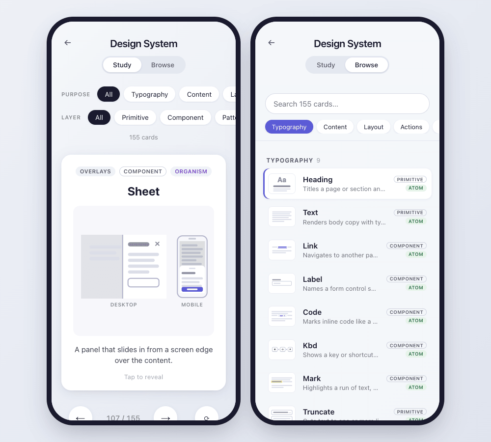

# Design System Flashcards

[](https://flashcards.pearpages.com)
[](https://github.com/pearpages/flashcards/actions/workflows/ci.yml)
[](https://github.com/pearpages/flashcards/actions/workflows/deploy.yml)
[](https://github.com/pearpages/flashcards/releases)
[](LICENSE)

A mobile-first flashcard deck for learning design system components: 155 components, each tagged three ways: its purpose (forms, navigation, overlays…), its layer (primitive, component, pattern) and its atomic design level (atom, molecule, organism, template). Each card has wireframe drawings and, for most, the iOS and Android equivalents.

**Try it: [flashcards.pearpages.com](https://flashcards.pearpages.com)** — works on phones and desktop, no sign-up.



## Tech Stack

- **Vite** + **React** + **TypeScript**
- **Framer Motion** — card stack animations, swipe gestures, spring physics
- **Plain CSS** — no utility frameworks
- **pnpm** — package manager
- **Vitest** — unit tests
- **@pearpages/credit** — the shared "Made by pearpages" footer

## Requirements

- Node.js >= 22
- pnpm

## Features

- **Browse by purpose** — every component listed in sections by purpose, with search (names, other names, summaries) and a jump bar; tap one to study it. A sidebar next to the cards on desktop, a Study/Browse switch on mobile
- **Deck picker** — the home screen lists every deck with a preview, its description and card count; a back arrow returns to it, and entering a deck starts fresh
- **Shareable links** — the URL follows the deck and card you're on (`#/design-system/card/sheet`) or the list (`#/design-system/browse`), and the Back button works
- **Component deck** — name, purpose, layer, atomic level, wireframe illustration and one-line purpose on the front
- **Tap to flip** — tap/click (or arrow up/down) to show when to use it, nearest alternatives, accessibility notes and native equivalents; tap again to go back to the front
- **Filters** — narrow the deck by purpose and/or layer (each deck declares its own filters); the atomic design level is shown as a badge
- **Desktop + mobile** — components that change shape on small screens show both versions side by side, or desktop · iOS · Android when the platforms differ
- **Native equivalents** — revealing a card shows its iOS (SwiftUI/UIKit) and Android (Compose Material 3) counterparts; search finds them too
- **Multiple decks** — add a folder under `src/decks/` and it shows up on the deck picker
- **Swipe navigation** — swipe left/right to navigate between cards
- **Keyboard navigation** — left/right arrow keys
- **Shuffle** — randomise the current deck
- **Mobile-first design** — full-width on mobile, centered and constrained on desktop
- **Spring animations** — natural card movement with Framer Motion spring physics

## Decks

Each deck is a folder in `src/decks/` and owns all of its data. The app discovers decks automatically and lists them on the home screen.

```
src/decks/
  design-system/
    deck.json          # title, description and the filters (facets) this deck offers
    cards.json         # the cards
    images/<id>.svg    # one illustration per card (optional)
```

### Adding cards

Add an entry to `src/decks/<deck>/cards.json`:

```json
{
  "id": "icon-button",
  "title": "IconButton",
  "facets": { "purpose": "actions", "layer": "component", "atomic": "atom" },
  "summary": "A compact button that shows only an icon.",
  "description": "When to use it, how it differs from its siblings, accessibility notes.",
  "aliases": ["Icon-only button"],
  "platforms": { "ios": "Button with SF Symbol", "android": "IconButton" }
}
```

| Field         | Required | Description                                                          |
| ------------- | -------- | -------------------------------------------------------------------- |
| `id`          | Yes      | Unique kebab-case slug; also the image filename                      |
| `title`       | Yes      | Shown on the card front                                              |
| `facets`      | Yes      | A value for every facet declared in `deck.json`                      |
| `summary`     | Yes      | One line, shown on the front (≤ 90 chars)                            |
| `description` | Yes      | Revealed on tap (≤ 280 chars to fit the card)                        |
| `aliases`     | No       | Other names for the same thing                                       |
| `platforms`   | No       | Native equivalents: `ios` (SwiftUI/UIKit), `android` (Compose M3), ≤ 60 chars each |

Optionally add `images/<id>.svg` (160×120). Cards without one show a `?` placeholder.

If the component looks different on small screens, also add `images/<id>.mobile.svg` (60×120, drawn inside a phone frame). The card then shows the desktop and mobile versions side by side.

When iOS and Android differ visibly (Switch, Date picker, Tabs…), add `images/<id>.ios.svg` and `images/<id>.android.svg` instead. The pair replaces the generic mobile drawing, so the card shows Desktop · iOS · Android.

Then run `pnpm validate`. It checks ids, required fields, facet values and text lengths, and warns about missing or orphan images. `pnpm build` runs it first and fails on errors.

### Adding a deck

Create `src/decks/<deck-id>/` with a `deck.json` (its `id` must match the folder name) and a `cards.json`:

```json
{
  "id": "css-properties",
  "title": "CSS Properties",
  "description": "What each property does.",
  "facets": [{ "key": "module", "label": "Module", "values": ["box model", "flexbox", "grid"] }]
}
```

Add `"filter": false` to a facet to show it as a badge on each card without a filter row (the design-system deck does this for `atomic`).

In the design-system deck, `layer` means `primitive` (unopinionated building block), `component` or `pattern` (a composition that solves a recurring problem).

## Deployment

Pushing a version tag (`v*`) builds the app
with GitHub Actions and publishes it to **GitHub Pages** at https://flashcards.pearpages.com.
The workflow can also be run by hand from the Actions tab.

To release from `main`: `npm version patch|minor|major` (bumps
`package.json`, commits and tags `v<version>`), push `main`, push the tag, then create the
GitHub release. In Claude Code, `/release <bump>` runs these steps.

## Getting Started

```bash
# Install dependencies
pnpm install

# Start dev server
pnpm dev

# Validate deck data
pnpm validate

# Run the tests once
pnpm test --run

# Build for production
pnpm build

# Preview production build
pnpm preview
```

## License

[MIT](LICENSE) © 2026 pearpages
