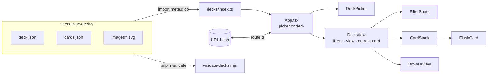

# Architecture

How Flashcards is built. It explains *how* things work. The rules that follow
from it are in [principles.md](principles.md), the reasons for each choice in
[decisions.md](decisions.md), the security surface in [security.md](security.md), and open
work in [GitHub Issues](https://github.com/pearpages/flashcards/issues). When code and this file disagree, the code is right and this
file is a bug.

## Shape

A single-page React 19 + TypeScript app built with Vite, with no backend. Entry point:
`index.html` → `src/main.tsx` → `src/App.tsx`, which shows the deck picker or one deck
depending on the URL. It ships as static files in `dist/`. All
content (cards, filters, drawings) is bundled at build time from `src/decks/`. Animations
use framer-motion. The UI is built on the pulp design system
([ADR-0019](docs/adr/0019-pulp-design-system.md)): `src/index.css` imports pulp's fonts,
tokens, reset and the stylesheet of each pulp component used; the app's own CSS (one file
per component, unlayered) uses pulp's semantic tokens only. The page is pinned to the light
scheme.

## Modules

| Path | Owns |
|---|---|
| `src/decks/<deck>/` | One deck: `deck.json` (title, description, facets, platform columns), `cards.json`, `images/*.svg` |
| `src/decks/index.ts` | Discovers decks and images with `import.meta.glob`; `decks`, `getCardImages()` |
| `src/types.ts` | `Deck`, `Facet`, `Platform`, `Flashcard` (with the optional `essential` flag), `FilterState` |
| `src/hiddenCards.ts` | Reads and writes a deck's hidden card ids in `localStorage` (`flashcards:hidden:<deckId>`), dropping anything that isn't a bundled card id |
| `src/App.tsx` | Mounts pulp's `DialogSystem` and `ToastProvider` (one toast at a time); picker or deck, from the URL; remounts `DeckView` on each visit so it starts fresh; the "Made by pearpages" footer (`@pearpages/credit`) under either |
| `src/route.ts` | URL hash ↔ route (`#/<deck>`, `#/<deck>/card/<id>`, `#/<deck>/browse`, legacy `#card/<id>`), push/replace history |
| `src/components/DeckPicker.tsx` | Home screen: one row per deck (cover drawing, title, card and essential counts), each a link to `#/<deck>` |
| `src/components/DeckView.tsx` | One deck: header (back, title, Filters with a count badge), the bar ("Card n of m" and the Study/Browse switch), filter state (facets, Essentials, known cards), current card, Back/forward within the deck, the "cards match your filters" toast |
| `src/components/CardStack.tsx` | The study stack: progress bar, order, swipe/keys, slide animation, which cards are flipped, the buttons (Show answer / I know this / Next card, Shuffle), toasts with Undo for hiding and shuffling, the empty state |
| `src/components/FlashCard.tsx` | One 5:7 card: front (facet line, title, drawings, summary) and back (description, aliases, one row per platform the deck declares), 3D flip; essential cards gold |
| `src/components/BrowseView.tsx` | Grouped list (one surface per section), search, jump bar with counts, scroll-spy, "filtered by" chips, Put back for known cards |
| `src/components/FilterSheet.tsx` | "Filter cards" sheet: a chip group per filterable facet with counts, Essentials and known-cards switches, Clear all / Show n cards |
| `src/components/InlineText.tsx`, `icons.tsx` | Card text with `backticked` code; stroke glyphs pulp-icons lacks (flip, shuffle, sliders, filled star) |
| `src/filters.ts`, `src/valueLabel.ts`, `src/inlineCode.ts` | Pure helpers: matching, relaxing and counting filters; facet value → label; splitting text on backticks |
| `src/hooks/` | `useKeyboardNav` (←/→ move, ↑/↓ flip, `H` hide, ignored while typing), `useMediaQuery`, `useHiddenCards` (the deck's hidden set, saved on change) |
| `scripts/validate-decks.mjs` | Node script that checks every deck before the build |

## Data flow

1. **Load:** at build time Vite bundles every `deck.json` and `cards.json`, and emits each
   SVG as its own hashed file in `dist/assets/` (only its URL goes in the JS);
   `decks/index.ts` groups them by folder. Image variants come from the file name:
   `<id>.svg`, `<id>.mobile.svg`, `<id>.ios.svg`, `<id>.android.svg`.
2. **Pick:** `App` reads the deck id from the hash. No (or an unknown) deck shows
   `DeckPicker`; choosing a deck pushes `#/<deck>` and mounts `DeckView` with a new key,
   so every visit starts on the first card with no filters. The back arrow pushes the
   picker route. Legacy links (`#card/<id>`, `#browse`) open the design-system deck, which they were made for.
3. **Filter:** `DeckView` keeps `FilterState` (`facet key → value | null`). Cards are first
   sorted into the order of the grouping facet (the first one with a filter row), so study
   order matches the browse list. `studyCards` apply every filter; `browseCards` apply all
   except the grouping facet, which becomes the list's sections instead. The Filters sheet
   sets them; its "Essential cards only" switch narrows both to cards with `essential: true`. Hidden cards are left out of
   `studyCards` unless the sheet's "Show cards I know" switch is on; browse keeps them,
   faded, with Unhide. Essential cards are painted gold on both faces instead of a badge.
4. **Study:** `CardStack` is keyed by deck + filters + an open counter, so changing filters
   or picking a card remounts it at the right card. It reports the visible card back to
   `DeckView` (`onCardChange`), which highlights it in the list and replaces the URL hash.
   The stack copies its cards on mount and is not keyed by the hidden set, so hiding a card
   doesn't remount it: the stack drops the card itself, slides to the next one and offers
   Undo in a toast for six seconds. Shuffle reshuffles the current stack, so hidden cards stay out, and can be undone.
5. **Browse:** picking a row sets the grouping filter to the card's value, relaxes any
   filter the card doesn't match (turning off Essentials, or turning on hidden cards, when
   needed), pushes `#/<deck>/card/<id>` and switches to study.
6. **History:** `App` and `DeckView` both listen to `popstate`. `App` handles changes of
   deck (entering or leaving one); `DeckView` handles moves within its deck, and going back
   to a card relaxes filters the same way so the card is in the stack.
7. **Layout:** `#root` is a full-height column: the screen grows and the credit footer
   sits under it (at the bottom of short pages). Below 960px one view shows at a time
   (Study/Browse switch) under the header and the bar. Study fills one screen
   (`.app--view-study` is `max(100dvh, 680px)`, and the credit is hidden there): the card is
   the largest 5:7 rectangle that fits the stage between the progress bar and the buttons
   (container query units, at least 380px tall), so shorter screens scroll instead, and
   `overscroll-behavior: none` stops the page bouncing while swiping. Toasts sit above the
   study buttons (`--app-shell-inset-block-end`). From 960px the browse list is a sticky
   sidebar and scrolls on its own, the Study/Browse switch is hidden and the filters sheet
   opens as a side panel.

The only persisted state is each deck's hidden cards, in `localStorage`
([ADR-0015](docs/adr/0015-essential-cards-and-local-hidden-cards.md)); filters and the
Essentials switch reset on reload, which starts from the URL hash.

## Build, test, deploy

- **Toolchain:** pnpm, Node 22 (`.nvmrc`), Vite 7, TypeScript ~5.9 (strict), ESLint 9.
- **Checks:** `pnpm validate` → `pnpm build` (runs validate, `tsc -b`, `vite build`),
  `pnpm lint` and `pnpm test --run` (Vitest, node environment; `src/route.test.ts`,
  `src/decks/index.test.ts`, `src/hiddenCards.test.ts`). `.github/workflows/ci.yml` runs lint, tests and build on
  every push to `main` and every pull request. UI changes are also checked in the browser
  at 375px and desktop widths.
- **Static assets:** `public/` holds `CNAME`, `favicon.svg`, `apple-touch-icon.png` and
  `og.webp` (the 1200×630 social card). `index.html` carries the meta description and the
  Open Graph / Twitter tags, so link previews work without running the app.
- **Deploy:** pushing a `v*` tag runs `.github/workflows/deploy.yml` (Node from `.nvmrc`,
  pnpm 10, `pnpm install --frozen-lockfile`, `pnpm lint`, `pnpm build`), which uploads
  `dist/` and publishes it to GitHub Pages at `flashcards.pearpages.com`; it can also be
  run by hand. The tag always equals the `package.json` version (`npm version`); the
  `release` skill in `.claude/skills/` runs the whole release. `public/CNAME` carries the domain into `dist/`, and DNS points the name at
  `pearpages.github.io`.
- **Bundle:** `vite.config.ts` never inlines SVGs (`assetsInlineLimit`), so drawings are
  separate files the browser fetches when an `` shows them; browse thumbnails use
  `loading="lazy"` ([ADR-0012](docs/adr/0012-card-drawings-as-separate-files.md)). The JS
  is ~1,040 kB (~325 kB gzipped) with ten decks: React, Framer Motion, pulp and the card text;
  the CSS is ~170 kB (~25 kB gzipped), mostly pulp's tokens for all its brands,
  so Vite still warns about chunk size.
