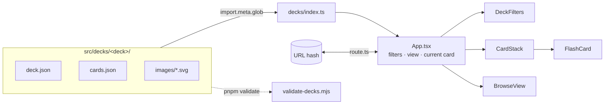

# Architecture

How Design System Flashcards is built. It explains *how* things work. The rules that follow
from it are in [principles.md](principles.md), the reasons for each choice in
[decisions.md](decisions.md), the security surface in [security.md](security.md), and open
work in [tasks.md](tasks.md). When code and this file disagree, the code is right and this
file is a bug.

## Shape

A single-page React 19 + TypeScript app built with Vite, with no backend. Entry point:
`index.html` → `src/main.tsx` → `src/App.tsx`. It ships as static files in `dist/`. All
content (cards, filters, drawings) is bundled at build time from `src/decks/`. Animations
use framer-motion; styling is plain CSS, one file per component.

## Modules

| Path | Owns |
|---|---|
| `src/decks/<deck>/` | One deck: `deck.json` (title, description, facets), `cards.json`, `images/*.svg` |
| `src/decks/index.ts` | Discovers decks and images with `import.meta.glob`; `decks`, `getCardImages()` |
| `src/types.ts` | `Deck`, `Facet`, `Flashcard`, `FilterState` |
| `src/App.tsx` | State: deck, filters, view (study/browse), current card; layout; Back/forward |
| `src/route.ts` | URL hash ↔ route (`#browse`, `#card/<id>`), push/replace history |
| `src/components/CardStack.tsx` | The study stack: order, swipe/keys, slide animation, shuffle, which cards are flipped |
| `src/components/FlashCard.tsx` | One card: front (badges, drawings, summary) and back (description, aliases, native names), 3D flip |
| `src/components/BrowseView.tsx` | Grouped list, search, jump bar, scroll-spy, "filtered by" chips |
| `src/components/DeckFilters.tsx` | One chip row per filterable facet, card count |
| `src/components/Tag.tsx` | Facet value badge (colour by value) |
| `src/hooks/` | `useKeyboardNav` (←/→ move, ↑/↓ flip, ignored while typing), `useMediaQuery` |
| `scripts/validate-decks.mjs` | Node script that checks every deck before the build |

## Data flow

1. **Load:** at build time Vite inlines every `deck.json`, `cards.json` and SVG URL;
   `decks/index.ts` groups them by folder. Image variants come from the file name:
   `<id>.svg`, `<id>.mobile.svg`, `<id>.ios.svg`, `<id>.android.svg`.
2. **Filter:** `App` keeps `FilterState` (`facet key → value | null`). Cards are first
   sorted into the order of the grouping facet (the first one with a filter row), so study
   order matches the browse list. `studyCards` apply every filter; `browseCards` apply all
   except the grouping facet, which becomes the list's sections instead.
3. **Study:** `CardStack` is keyed by deck + filters + an open counter, so changing filters
   or picking a card remounts it at the right card. It reports the visible card back to
   `App` (`onCardChange`), which highlights it in the list and replaces the URL hash.
4. **Browse:** picking a row sets the grouping filter to the card's value, relaxes any
   filter the card doesn't match, pushes `#card/<id>` and switches to study.
5. **History:** `popstate` re-reads the hash; going back to a card relaxes filters the
   same way so the card is in the stack.
6. **Layout:** below 960px one view shows at a time (Study/Browse switch); from 960px the
   browse list is a sticky sidebar and scrolls on its own.

No state is persisted: reload starts from the URL hash with no filters.

## Build, test, deploy

- **Toolchain:** pnpm, Node 22 (`.nvmrc`), Vite 7, TypeScript ~5.9 (strict), ESLint 9.
- **Checks:** `pnpm validate` → `pnpm build` (runs validate, `tsc -b`, `vite build`) and
  `pnpm lint`. No automated tests yet; UI changes are checked in the browser at 375px and
  desktop widths.
- **Deploy:** `.gitlab-ci.yml` has a manual `pages` job on `main` (Node 22 image,
  `pnpm install`, `pnpm build`, `dist/` → `public/`) that publishes to GitLab Pages. The
  source is also pushed to a public GitHub repository.
- **Bundle:** small SVGs are inlined as data URIs, so the JS bundle is ~750 kB (~175 kB
  gzipped) and Vite warns about chunk size.
