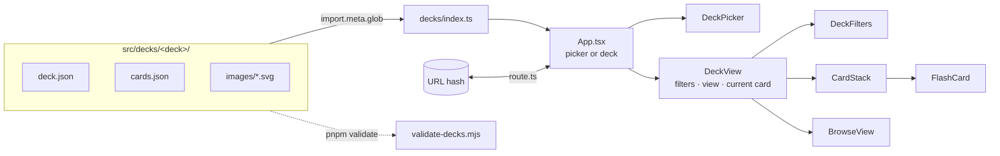

# Architecture

How Design System Flashcards is built. It explains *how* things work. The rules that follow
from it are in [principles.md](principles.md), the reasons for each choice in
[decisions.md](decisions.md), the security surface in [security.md](security.md), and open
work in [tasks.md](tasks.md). When code and this file disagree, the code is right and this
file is a bug.

## Shape

A single-page React 19 + TypeScript app built with Vite, with no backend. Entry point:
`index.html` → `src/main.tsx` → `src/App.tsx`, which shows the deck picker or one deck
depending on the URL. It ships as static files in `dist/`. All
content (cards, filters, drawings) is bundled at build time from `src/decks/`. Animations
use framer-motion; styling is plain CSS, one file per component.

## Modules

| Path | Owns |
|---|---|
| `src/decks/<deck>/` | One deck: `deck.json` (title, description, facets), `cards.json`, `images/*.svg` |
| `src/decks/index.ts` | Discovers decks and images with `import.meta.glob`; `decks`, `getCardImages()` |
| `src/types.ts` | `Deck`, `Facet`, `Flashcard`, `FilterState` |
| `src/App.tsx` | Picker or deck, from the URL; remounts `DeckView` on each visit so it starts fresh; the "Made by pearpages" footer (`@pearpages/credit`) under either |
| `src/route.ts` | URL hash ↔ route (`#/<deck>`, `#/<deck>/card/<id>`, `#/<deck>/browse`, legacy `#card/<id>`), push/replace history |
| `src/components/DeckPicker.tsx` | Home screen: one tile per deck (preview fan, title, description, count) |
| `src/components/DeckView.tsx` | One deck: filters, view (study/browse), current card, back arrow, Back/forward within the deck |
| `src/components/CardStack.tsx` | The study stack: order, swipe/keys, slide animation, shuffle, which cards are flipped |
| `src/components/FlashCard.tsx` | One card: front (badges, drawings, summary) and back (description, aliases, native names), 3D flip |
| `src/components/BrowseView.tsx` | Grouped list, search, jump bar, scroll-spy, "filtered by" chips |
| `src/components/DeckFilters.tsx` | One chip row per filterable facet, card count |
| `src/components/Tag.tsx` | Facet value badge (colour by value) |
| `src/hooks/` | `useKeyboardNav` (←/→ move, ↑/↓ flip, ignored while typing), `useMediaQuery` |
| `scripts/validate-decks.mjs` | Node script that checks every deck before the build |

## Data flow

1. **Load:** at build time Vite inlines every `deck.json`, `cards.json` and SVG URL;
   `decks/index.ts` groups them by folder. Image variants come from the file name:
   `<id>.svg`, `<id>.mobile.svg`, `<id>.ios.svg`, `<id>.android.svg`.
2. **Pick:** `App` reads the deck id from the hash. No (or an unknown) deck shows
   `DeckPicker`; choosing a deck pushes `#/<deck>` and mounts `DeckView` with a new key,
   so every visit starts on the first card with no filters. The back arrow pushes the
   picker route. Legacy links (`#card/<id>`, `#browse`) open the design-system deck, which they were made for.
3. **Filter:** `DeckView` keeps `FilterState` (`facet key → value | null`). Cards are first
   sorted into the order of the grouping facet (the first one with a filter row), so study
   order matches the browse list. `studyCards` apply every filter; `browseCards` apply all
   except the grouping facet, which becomes the list's sections instead.
4. **Study:** `CardStack` is keyed by deck + filters + an open counter, so changing filters
   or picking a card remounts it at the right card. It reports the visible card back to
   `DeckView` (`onCardChange`), which highlights it in the list and replaces the URL hash.
5. **Browse:** picking a row sets the grouping filter to the card's value, relaxes any
   filter the card doesn't match, pushes `#/<deck>/card/<id>` and switches to study.
6. **History:** `App` and `DeckView` both listen to `popstate`. `App` handles changes of
   deck (entering or leaving one); `DeckView` handles moves within its deck, and going back
   to a card relaxes filters the same way so the card is in the stack.
7. **Layout:** `#root` is a full-height column: the screen grows and the credit footer
   sits under it (at the bottom of short pages). Below 960px one view shows at a time
   (Study/Browse switch) under a one-row header. Study is locked to one screen
   (`#root:has(.app--view-study)` is `100dvh`, overflow hidden): the card takes the height
   left between the filters and the buttons (up to 560px, tighter below 700px tall), and
   `overscroll-behavior: none` stops the page bouncing while swiping. From 960px the browse
   list is a sticky sidebar and scrolls on its own, so the footer sits just below it.

No state is persisted: reload starts from the URL hash with no filters.

## Build, test, deploy

- **Toolchain:** pnpm, Node 22 (`.nvmrc`), Vite 7, TypeScript ~5.9 (strict), ESLint 9.
- **Checks:** `pnpm validate` → `pnpm build` (runs validate, `tsc -b`, `vite build`),
  `pnpm lint` and `pnpm test --run` (Vitest, node environment; `src/route.test.ts`,
  `src/decks/index.test.ts`). `.github/workflows/ci.yml` runs lint, tests and build on
  every push to `main` and every pull request. UI changes are also checked in the browser
  at 375px and desktop widths.
- **Static assets:** `public/` holds `CNAME`, `favicon.svg`, `apple-touch-icon.png` and
  `og.webp` (the 1200×630 social card). `index.html` carries the meta description and the
  Open Graph / Twitter tags, so link previews work without running the app.
- **Deploy:** pushing a `v*` tag runs `.github/workflows/deploy.yml` (Node from `.nvmrc`,
  pnpm 10, `pnpm install --frozen-lockfile`, `pnpm lint`, `pnpm build`), which uploads
  `dist/` and publishes it to GitHub Pages at `flashcards.pearpages.com`; it can also be
  run by hand. The tag always equals the `package.json` version (`npm version`); the
  `release` skill in `.claude/skills/` runs the whole release. `public/CNAME` carries the domain into `dist/`, and DNS points the name at
  `pearpages.github.io`.
- **Bundle:** small SVGs are inlined as data URIs, so the JS bundle is ~750 kB (~175 kB
  gzipped) and Vite warns about chunk size.
